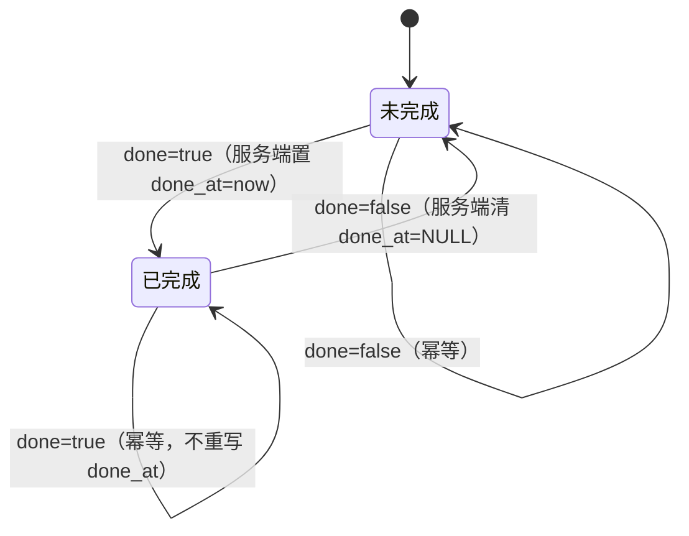

# ADR-20261012：地点级「完成」状态与进度汇总（子行程卡片进度）

- 状态：已完成（Phase 5，2026-10-12；后端 65 测试全绿、E2E 26 断言全通过、已部署上线）
- 日期：2026-10-12
- 关联：ADR-20260929-Waynote-cascade-and-secrets（places 级联不变量）、ADR-20260929-Waynote-glass-shell-restructure（视觉语言）、ADR-20260929-Waynote-deployment-systemd（部署流程）

---

## 1. 需求与背景（Phase 1）

用户原话：
1. 「子行程卡片是不是少了个进度的功能，就是旅游完一个地方我可以手动勾选完成，然后进度也随之更新那种，请你帮我设计」
2. 「子行程卡片现在好像没有进度功能，就是子行程卡片应该是可以完成的，完成之后就会更新进度，请你进行设计」

**用户已抉择（本 ADR 的输入约束）：**
- 勾选粒度：**只存地点级完成状态**，天/整程进度全部由它派生汇总（单一事实来源）。
- 展示位置（全选）：① 每天卡片头部小进度 ② 行程详情页头部整程进度条 ③ 行程卡（列表页）进度 ④ 「我的」页统计加"已完成"。

**隐式约束：**
- 跨设备/跨视图一致 → 完成状态必须落库（不接受 localStorage 类客户端补丁）。
- 不破坏既有契约：`TripOut` 详情不带计数字段（已被 `test_trips_list_counts.py` 锁定）；列表计数走标量子查询（避免 N+1）。
- 视觉延续：淡雅翡翠、按钮无描边、容器动效线性/位移动效弹簧、`prefers-reduced-motion` 兜底、文字对比度 ≥4.5:1。

## 2. 现状评估（缺什么）

| 层 | 现状 | 差距 |
|---|---|---|
| 数据 | `places` 无完成字段（`name/address/lat/lng/category/start_time/end_time/notes/sort_order`） | 无事实来源 |
| 接口 | `PATCH /trips/{id}/places/{id}`（部分更新）；列表 `day_count/place_count` 标量子查询模式 | 无 `done`、无 `done_count`、无批量完成 |
| UI | 行程卡=标题/状态/日期/「已安排 X 天 · Y 个地点」；详情页=每日卡+地点行；我的=行程/天/地点三项 | 无勾选控件、无任何进度展示 |

## 3. 根因/差距分析

| 层级 | 内容 | 证据 |
|---|---|---|
| 症状 | 没有"手动勾选完成 + 进度更新" | 全库 grep 无 done/progress 字段与组件 |
| 直接原因 | `Place` 无双态字段；计数只统计存在性不统计完成数；UI 无进度组件 | `models/place.py`、`api/v1/trips.py:28-37`、`TripCard.vue:22-26` |
| 根因 | **缺少"完成状态"的持久化事实来源**；若用客户端本地存储补上，进度会退化为"单设备可见、列表页不可信、跨端不一致" | — |

## 4. 泛化边界、不变量与反例

**输入域**：任意行程（含 0 地点/0 天）、任意天（含 0 地点）、地点可在某天也可"待定"（`day_id=NULL`）、任意数量（0..N，N 典型 ≤ 数百）。

**不变量（实现与测试都必须维持）：**
- I1：`done_at IS NULL ⟺ done = false`（DB CHECK 约束 + 唯一写入路径共同保证）。
- I2：每天进度 = |{p∈该天: p.done}| / |{p∈该天}|，**派生计算，不落库**。
- I3：整程进度 = |{p∈该行程: p.done}| / |{p∈该行程}|，**包含待定地点**（它们是行程的正式计划项）。
- I4：列表 `done_count` 与 I3 分子同口径（同一谓词）。
- I5：分母为 0 → 不渲染进度（返回 null），**不显示 0% / 不显示"已完成"**。
- I6：写入幂等——`done` 未变化时不重写 `done_at`（完成时间不被无意义刷新）。

**明确不适用（反例即边界）：**
- 按时间自动完成（时间门控）→ 不实现（用户要求"手动"）。
- 天级独立完成标记 → 不实现（双重事实来源会产生"天完成了但有点未完成"的矛盾态；天的"完成"由 I2 派生 + 一键批量动作实现）。
- 已完成地点自动沉底/重排 → 不实现（排序是显式动作，避免旅行中布局跳动）。
- 离线队列/本地暂存 → 不实现（乐观更新 + 失败回滚已足够）。

## 5. 设计（Phase 2）

### 5.1 数据层（迁移 `places`）

```
places.done     BOOLEAN NOT NULL DEFAULT false      -- server_default=text("false")
places.done_at  TIMESTAMP NULL                      -- 仅由服务端写入
CONSTRAINT ck_places_done_at_consistent CHECK ( (NOT done AND done_at IS NULL) OR (done AND done_at IS NOT NULL) )
```

- 新迁移 revision（`down_revision = 9d1f4c7b2a58`），`downgrade` 完整可逆（drop constraint/columns）。
- `PlaceCreate` **不接受** `done`（新地点一律未完成）；`PlaceOut` 增加 `done: bool`、`done_at: datetime | None`。

### 5.2 状态机（唯一写入路径）



`apply_done_state(place, done)`：`done == place.done` → no-op；否则置 `place.done`，`place.done_at = datetime.now() or None`。
批量动作等价于对该天所有 `done != 目标值` 的行执行同一状态迁移（单条 UPDATE，天然原子）。

### 5.3 API 契约

| # | 端点 | 请求 | 响应 | 语义/错误 |
|---|---|---|---|---|
| A1 | `GET /api/v1/trips` | — | `list[TripListItem]`，新增 `done_count: int = 0` | 标量子查询 `count(places.id) where trip_id=Trip.id and done`；无 N+1 |
| A2 | `PATCH /api/v1/trips/{trip_id}/places/{place_id}` | `PlaceUpdate` 新增 `done: bool \| None` | `PlaceOut`（含 done/done_at） | 省略=不改；显式 `null`→422（`done` 不可为空）；未变=幂等；404 沿用归属校验 |
| A3 | `PATCH /api/v1/trips/{trip_id}/days/{day_id}/done` | `DayDoneIn{done: bool}` | `DayDoneOut{day_id, done, changed}` | 同一事务内对该天每行应用同一状态迁移函数（见 §11 实施偏差①）；幂等（changed=0）；404 同 days 路由约定；日志 event=`day.done` |

复杂度：A1 每行 +1 个 O(1) 标量子查询（仍单条 SQL）；A2 O(1)；A3 单语句精确定位 `done != :target` 的行，O(k) 行（k=该天地点数，避免 N 次请求与部分失败态）。

### 5.4 前端设计

**新纯函数** `frontend/src/utils/progress.ts`（可复用的唯一进度口径）：
```ts
export interface Progress { done: number; total: number; percent: number }
export function progressOfCounts(done: number, total: number): Progress | null // total<=0→null；done 夹取到 [0,total]
export function progressOf(items: readonly { done: boolean }[]): Progress | null
```

**类型/接口层**：
- `api/places.ts`：`Place` + `done/done_at`；新增 `PlaceUpdate = Partial<PlaceCreate> & { done?: boolean }`；`updatePlace` 用该类型。
- `api/days.ts`：`setDayDone(tripId, dayId, done): Promise<DayDoneResult>`。
- `api/trips.ts`：`TripListItem` + `done_count: number`。

**TripDetailView（核心交互）**：
- 计算：`dayProgress = computed(Map<dayId, Progress|null>)`（一次 O(P+D) 遍历，模板 O(1) 查表）；`tripProgress = computed(() => progressOf(places))`。
- 地点行（含待定地点）首位加勾选圆钮：`<button role="checkbox" :aria-checked>`，22px，未选=细环、选中=翡翠填充+白勾+弹簧 pop（reduced-motion 关闭动画）。
- 已完成行：名称划线 + `.place-main` 淡化（勾钮保持清晰）。
- 单击 = 乐观更新：先翻本地 → `updatePlace({done})` → 用响应替换该条；失败回滚 + 「操作失败，请重试」；同一条在途时禁用（防连点）。
- 每天卡片头部（day-actions 前）加进度小徽章：`2/4`；全部完成 → 勾图标 +「已完成」；0 地点不渲染。
- 「全部完成」按钮（0 < done < total 时显示，带在途禁用）：`setDayDone(day.id, true)` 成功后 `loadAll()`（沿用既有"变更后整体刷新"模式）。

**TripCard（列表页）**：body 与 foot 之间加细进度带：轨道 6px + 右对齐 `5/12`（`progressOfCounts(done_count, place_count)`，place_count=0 不渲染）；`role="progressbar"` + aria 文案。

**TripDetailView hero**：`hero-stats` 下方加整程进度行（轨道 + 填充 + `已完成 5/12 · 42%`），仅 `tripProgress` 非空时渲染；`role="progressbar"`。

**MeView**：统计从 3 项扩为 4 项（`stats.done = Σ trip.done_count`，来自列表接口，无新请求）；网格 `repeat(4,1fr)`、骨架同步 4 格；label=「已完成」。

**不动的**：排序/移动/删除逻辑、`loadAll` 刷新模式、详情 `TripOut` 契约、日历/地图页。

### 5.5 为什么不是"临时补丁"

- 补丁方案（localStorage / 仅前端）在列表页与跨端场景立即失真，属于症状级解决。
- 本设计的复杂度增量恰好覆盖不变量：1 布尔列 + 1 审计列 + 1 CHECK + 1 条纯函数口径 + 1 个原子批量动作；没有冗余状态，没有需要"对账"的双写。
- 派生聚合（I2/I3）保证任何视图看到的进度永远同源一致。

## 6. 被否决的替代方案

| 方案 | 否决理由 |
|---|---|
| 前端 localStorage 存勾选 | 跨端/清缓存即丢；列表页进度不可信（根因未解决） |
| 只做天级完成标记 | 丢失"玩完一个地点勾一下"的粒度（用户已否决） |
| 天级+地点级各存独立标记 | 双重事实来源 → 矛盾态需要覆盖规则，测试面与维护成本高 |
| 批量完成 = 前端 N 次 PATCH | 部分失败会留下半完成状态，且 N 次往返；单条 UPDATE 原子且更快 |
| 用 `trip.status` 字段表达进度 | status 是规划阶段语义（planning/…），与"旅行中逐点打卡"正交，混用会互相干扰 |

## 7. 防复发机制

1. **DB CHECK（I1）**：任何未来代码路径（含裸 SQL）都无法写出 `done=true, done_at=NULL`。
2. **回归测试**：后端 9 条（见 §8）；列表计数测试扩展 `done_count` 断言，锁死口径 I3/I4。
3. **单一口径**：前端所有进度来自 `utils/progress.ts`（0 分母语义 I5 内聚一处）。
4. **代码注释**：模型/端点标注不变量与"唯一写入路径"要求。
5. **本 ADR**：记录否决方案与边界，防止后续把天级标记/自动完成"补回来"造成双写。

## 8. 测试计划（Phase 4 执行清单）

| ID | 类型 | 场景 | 期望 | 覆盖 |
|---|---|---|---|---|
| T1 | Happy | PATCH `{done:true}` | 200；done=true；done_at 非空；重新 GET 持久 | I1/I6 |
| T2 | 不变量 | 再次 PATCH `{done:true}` | done_at 保持不变（幂等） | I6 |
| T3 | Happy | PATCH `{done:false}` | done=false；done_at=NULL | 状态机 |
| T3b | 边界/错误 | PATCH `{done:null}` | 422；状态不变 | 输入校验 |
| T4 | 计数口径 | 列表含：已勾/未勾/待定地点 | done_count 只计已勾（含待定）；≤ place_count；他人行程不受影响 | I3/I4 |
| T5 | 批量 | `PATCH …/days/{id}/done {done:true}` | changed=当天未完成数；该天全勾且 done_at 置位；其它天不变；再次调用 changed=0 | 原子/幂等 |
| T6 | 反例（DB） | 裸 SQL 写 `done=true, done_at=NULL` | IntegrityError（CHECK 拒写） | I1 |
| T7 | 回归 | 既有 counts/cascade 测试 + 详情契约 | 全绿；详情仍无计数字段 | 契约 |
| T8 | 归属 | 他人 trip/day/place | 404 | 安全 |
| T9 | 批量反向 | `{done:false}` | 全清 + done_at=NULL；changed 正确 | 对称性 |
| T10 | E2E（CDP，本地） | 勾选/取消/批量/刷新/待定/键盘与 aria | 行样式、天徽章、hero、列表卡、我的页四处同步且一致 | I2/I3/I5 |
| T11 | 前端守卫 | `npm run lint`（含 check:tokens）+ type-check + build | 全绿（新 CSS 不得引用未定义令牌） | 视觉契约 |

## 9. 实施顺序（Phase 3）

1. 迁移 + 模型（done/done_at/CHECK）→ `alembic upgrade head` 验证 + downgrade 往返。
2. `PlaceOut/PlaceUpdate` + PATCH 逻辑（apply_done_state、null→422）→ schemas/端点。
3. 列表 `done_count` 标量子查询。
4. days 批量端点 + 日志。
5. 后端测试 T1–T9 + 既有测试全跑。
6. 前端：progress.ts → 类型层 → TripDetailView（勾钮/徽章/hero/批量）→ TripCard → MeView → 样式（含 reduced-motion）。
7. T10/T11 验证；部署（bundle → update.sh 跑迁移 → dist）；线上冒烟 + 请用户目视。

## 10. 已知限制与后续（Phase 5 回填）

- `done_at` v1 不展示（为审计/未来统计保留）；服务端时钟为写入时刻。
- 若单行程地点数增长到数百，`dayProgress` 可进化为 Map 缓存（现已是一次计算，非逐行过滤）。
- 后续可选：完成时的"今日小结"、按完成时间的足迹视图、旅行结束后锁定勾选等，均不需改数据模型。

---

## 11. 实施与验证结果（Phase 4/5，2026-10-12）

### 11.1 实施偏差（对已批准设计的偏离及理由）

① **批量接口的内部实现**：设计写的是"单条 UPDATE"，实现为**同一事务内遍历该天地点、逐行调用 `apply_done_state`**（k ≤ 该天地点数）。
   理由：`apply_done_state` 是不变量 I1 的**唯一实现**；若用 SQL 批量 UPDATE 就必须在 SQL 里复刻 `done_at` 规则，形成第二份实现（两份实现迟早漂移）。原子性/幂等/changed 语义与设计完全一致，外部行为无差异。

② **乐观回滚的"出现过"验证**：失败注入时乐观态仅存在几十毫秒，普通轮询采样抓不到；E2E 改用页面内 MutationObserver 记录，作为"乐观更新确实发生且被回滚"的证据。

③ **错误提示文案**：网络层失败时 `apiErrorMessage` 给出的是"网络异常，请检查网络连接"（比组件兜底文案"操作失败"更准确），E2E 按实际行为断言。

### 11.2 验证证据

- **后端 65 个测试全绿**（58 存量 + 7 新增）：
  - `test_place_done.py`：置位/清空 done_at、幂等不重写完成时间、显式 null→422、列表 done_count 口径（含待定、≤place_count、他人隔离、详情契约不变）、批量原子/幂等/反向/越权 404、**DB CHECK 反例（裸 SQL 写非法态必须被拒）**。
  - `test_trips_list_counts.py` 扩展：done_count 断言 + 详情仍不携带任何计数字段。
  - 注：`test_logging.py` 的 3 条在本机默认临时目录被占用时会 ERROR（环境问题，非代码）；用 `--basetemp` 指定可写目录后 9 passed。
- **前端守卫**：`check:tokens`（曾抓到 PlaceDoneToggle 的 `#fff` 硬编码与"宝石表面+边框缺 background-origin"两处，已按设计系统修正）、type-check、build 全绿。
- **E2E 26 断言全通过**（CDP 真实全栈：造数→勾选→批量→刷新→列表→我的→键盘→失败回滚→移动端布局）：
  - 乐观即时（行划线/徽章/进度条同帧响应）→ 服务端确认一致；
  - 「全部完成」原子生效、按钮随状态隐现；刷新持久化；
  - 列表卡 `1/3`+aria 25+填充 25%、0 地点卡不渲染进度；
  - 我的页统计与列表接口汇总一致；Space 切换 + aria-checked 同步；
  - 注入网络失败：乐观态出现→被回滚→错误提示→进度不变；
  - 移动端 390px：勾钮与内容同行、操作按钮换行右对齐（flex-wrap 探针通过）。
- **迁移**：`upgrade head` / `downgrade -1` / 再 `upgrade head` 往返通过；`\d places` 确认列与 CHECK 存在。

### 11.3 已知限制与后续

- `done_at` 仅用于审计/未来统计，UI 暂不展示。
- 在途禁用窗口（防连点）约 <100ms；快速双击的第二次点击会被忽略（设计行为）。
- 后续可选：足迹视图（按 done_at）、旅行结束自动归档勾选、导出已完成清单——均不需要改数据模型。

